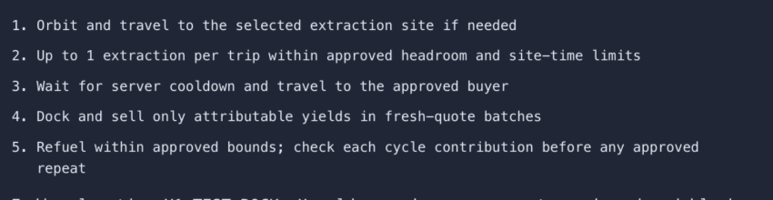
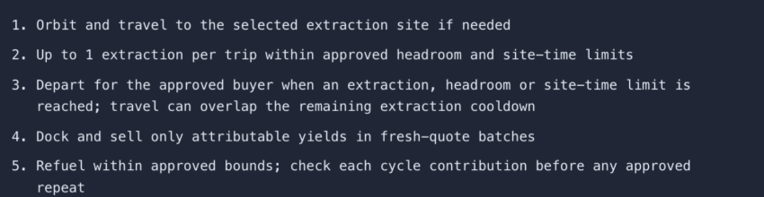

# DOC01 verification · November 1, 2026

Refs [issue #1](https://github.com/giantsoup/spacetraders/issues/1) and [PR #2](https://github.com/giantsoup/spacetraders/pull/2). Initial PR/worktree head: `a4a80d767bf2ffd58ff2d030fc84d2b9f0dda06f`; fetched main: `98b8792ffc0ce36a50ba5b9149b3049f5bd1e6fb`. No hard prerequisites. This evidence covers DOC01's documentation, tracking and preview copy only.

## Real application before and after

| Before: incorrectly waits for cooldown | After: departure permits cooldown/travel overlap |
| --- | --- |
|  |  |

[Before context](before-context.png) · [After context](after-context.png) · [After at 390px](after-mobile.png) · [Rendered status report](status-report.png).

BEFORE uses the untouched initial PHP source, captured before editing. AFTER uses final PHP source and the same owned disposable SQLite/world, synthetic pilot, LOCAL-1 ship, version-2 draft revision 1, limits and browser profile. Desktop viewport: 1100 × 1000 CSS pixels, dark appearance, America/Los_Angeles. T3 saved 1280 × 1164 images; both focused crops use the identical source rectangle `(395, 555, 850, 220)`. Only preview expiry naturally advances. The engine stayed off, approval remained disabled, and the world recorded zero mutations. No live game data or credentials appear.

The final copy wrapped without horizontal overflow at 390 × 844. Every delivered image was inspected for legibility and truthful state. The report rendered on a dark background (`rgb(10, 15, 24)`), retained 42 rows and filtered UI01 to one row. Original classifications are labeled as dated audit findings; the current index distinguishes UI01's separate unpublished branch from main.

## Executed checks

| Check | Actual result | Evidence |
| --- | --- | --- |
| Initial baseline `LocalAutomationTest` + `OpportunityTest` | 90 tests, 484 assertions, one failure: unchanged `OpportunityTest.php:561` quote timestamp equality, owned by QA01 | [before-tests.txt](before-tests.txt) |
| New preview/departure regression | Pass: 1 test, 20 assertions. All three limits permit departure and navigation with 80 seconds of extraction cooldown remaining; preview creates no ShipAction or upstream mutation | [preview-departure-test.txt](preview-departure-test.txt) |
| Final `scripts/verify.sh` | Pass: both production builds identical; frontend/store/gameplay/local-time/tutorial/guide and environment checks passed; 294 backend tests, 1,548 assertions; Pint and whitespace passed | [verify.txt](verify.txt) |
| Tracking regressions | Pass: 6 tests covering snapshot, changed head/files including removal, draft/ready/merged lifecycle, invalid branches/cross-links, pagination and dependency cycles | [tracking-tests.txt](tracking-tests.txt) |
| Read-only GitHub tracking before push | All 42 issue/PR pairs verified; feature acceptance not assessed | [tracking-before-push.txt](tracking-before-push.txt) |
| Real automation workers | Pass: complete (28 checks), contract_accept (14), buy (16), contract_deliver (28), contract_fulfill (30), each with its own fake world/database | [automation-worker.txt](automation-worker.txt) |
| Focused final Pint | Pass | [pint.txt](pint.txt) |

The final suite passed once. The pre-existing intermittent QA01 failure was reproduced on the baseline and was not repaired by DOC01. No repeated green-suite claim is made. During test development, a fixed application clock disagreed with SQLite's creation timestamp and made an investigation stale. Removing that unnecessary override corrected the new test setup; no application guard was weakened.

Locked dependencies were installed independently in this worktree. No manifest or lockfile changed. Both builds left tracked assets unchanged. The reviewed deployment plan is unchanged from the initial PR baseline. A mechanical comparison confirmed all 42 original task records, evidence, dependencies, acceptance, branches and issue/PR URLs remain identical; only hash/file field names changed to `audit_head_sha` and `audit_changed_files`.

Logs remove terminal color codes and replace personal paths with `<owned-worktree>` or `<owned-disposable-fixture>`. No result or failure was removed. Synthetic credentials, environment files, keys, databases and private fixture metadata stay outside committed evidence.

## Reproduce offline

Use owned locked dependencies and PHP 8.4.1+ within the 8.4 series, matching this baseline. OPS01 owns the later runtime migration.

```sh
PHP_BIN=/path/to/php84 PNPM_BIN=/path/to/pnpm-12.16.1 bash scripts/verify.sh
/path/to/php84 vendor/bin/phpunit --colors=never --filter test_preview_explains_departure_before_cooldown_at_each_approved_limit
python3 -m unittest discover -s tests/PlanTracking -v
python3 scripts/verify-plan-tracking.py
/path/to/php84 scripts/verify-automation-worker.php
```

Optional metadata readback: `python3 scripts/verify-plan-tracking.py --github` uses authenticated `gh` read-only. `--github --snapshot` requires the original draft/head/file snapshot; feature progress is expected to fail that historical mode.

For browser reproduction, run `scripts/mvp-fixture.php --isolated`. Use only its private environment with a finite loopback server and owned session/cache/storage/request-budget paths, then log in with its generated synthetic account. Investigate Mining, select LOCAL-1 / X1-TEST-ROCK via X1-TEST-ROCK, stage the default one-extraction plan, and preview with the engine off. Capture the review panel at the viewport above. Do not start an engine or approve gameplay. Shut down the owned server afterward.

## Publication readback

All six hosted PNGs at evidence commit `b109ca410b8f2bbfe69108199ecddf9abdb88beb` returned HTTP 200 and matched local SHA256 values. PR #2 was confirmed open/draft on its designated branch with no auto-merge. GitHub reported no check runs, status contexts or submitted reviews at readback. Local verification remains distinct from hosted CI.

During publication, QA01 PR #4 merged independently into main at `683d5efa995709beee66f39ab5f8d67c432cb8f3`. The baseline failure above is historical evidence from DOC01's original base. Main now contains QA01's correction, which was not imported or rerun in this worktree. DOC01 was reported mergeable without conflicts.

## Review, limits and rollback

DOC01 was self-reviewed without delegation. The initial audit's Sonnet 5.5 final-review attempt was rate-limited; that historical outcome remains recorded. No new independent review ran and no substitute model was used. Taylor's review remains pending, so PR #2 stays draft.

No shared/live database, primary environment, global Herd configuration, deployment, real game mutation, paid model call, external notification or credential change occurred. Only owned fake-provider workers exercised mutations. UI01 integration/acceptance, OPS work and LIVE evidence remain with their task pairs. QA01 merged separately as recorded above. Publishing the plan is not deployment acceptance.

Rollback is a normal revert of the DOC01 commit. Application output changes by one preview string. Command rules, durable execution, auth, reserve bounds, Stop, reset handling and uncertainty behavior remain unchanged. Tracking consumers must use the explicitly named audit fields; the pinned original manifest remains available in the status index.
