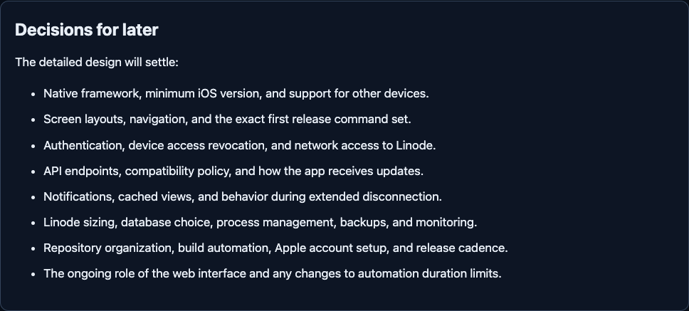
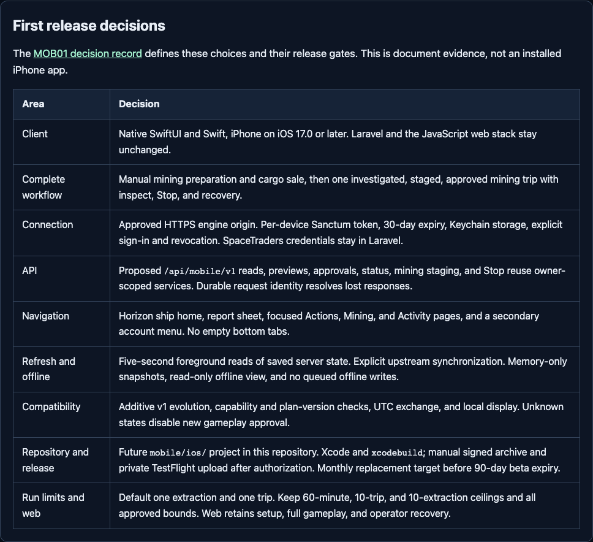

# MOB01 review evidence

This package documents [issue #29](https://github.com/giantsoup/spacetraders/issues/29) and existing draft [PR #30](https://github.com/giantsoup/spacetraders/pull/30). Baseline: `f58177bab2cba7d5af69c8443fb6c72f26caa2ae`. Work was limited to release scope, technical decisions, and document evidence. There is no mobile project or API implementation in this change.

## Before and after document evidence

The before images render the original `docs/ios-app-plan.md` from the exact baseline, captured before editing that plan. The after images render the final plan. These are browser-rendered documents, not application screens, prototypes, or an installed iPhone app.

| Before | After |
| --- | --- |
|  |  |
| [Plan context](evidence/2026-11-01-mob01/before-context.png) | [Plan context](evidence/2026-11-01-mob01/after-context.png) |

Both use the same owned renderer, 1120 × 900 viewport, scale 1, UTC timezone, and light OS preference. The documents enforce dark mode. Focus images capture their whole section without truncation. All four delivered images were inspected for legibility and truthful labels. No game fixtures, login, environment file, database, or private browser profile was needed for these document captures. The browser used a new isolated context and blocked external requests.

The evidence directory retains the exact Markdown snapshots, full-context and focused HTML, PNGs, and JSON containing browser version, source SHA-256, layout checks, and blocked-request/error results. The [rendered decision](evidence/2026-11-01-mob01/decision.html) is generated from [the actual decision record](../adr/0001-first-iphone-release.md). It has no simulated app controls or gameplay values.

## Verification performed

The record below separates document acceptance from application behavior. A passing existing regression does not prove the proposed mobile API, physical iPhone workflow, or hosted operation.

| Check | Actual result |
| --- | --- |
| Branch, remote PR head, baseline, dirty state | Clean designated worktree; local and fetched remote head matched the expected baseline before editing. No hard prerequisites declared for MOB01. |
| Source review | README, manifests, routes, requests, command executor/rules, staged automation, engine manager/gate, existing plans, design brief, and relevant tests inspected. No mobile project or complete mobile API found. |
| Primary-source review | Apple SwiftUI Observation availability, Keychain accessibility, Xcode compatibility, upload/TestFlight requirements, and Laravel Sanctum mobile authentication, expiry, and revocation checked. Links are next to decisions. Recheck changing Apple build requirements at release time. |
| `node docs/issue-29/render-evidence.mjs before` and `after` | Passed with the tool modules described below. Dark theme under light OS preference, no horizontal overflow, no page errors, and no external requests. After mode also validates local document links and anchors. |
| `node --check docs/issue-29/render-evidence.mjs` | Passed. |
| `node scripts/verify-gameplay.mjs` | Passed. Valid, independent UUID submission keys. |
| `node scripts/verify-local-time.mjs` | Passed in Los Angeles, New York, Tokyo, and UTC, retaining UTC source values. |
| `node scripts/verify-tutorial.mjs` | Passed. Course structure, malformed progress recovery, deduplication, and owner/agent/reset isolation. |
| `node scripts/verify-guided-flight.mjs` | Initially stopped because this fresh worktree lacked `vendor/autoload.php`. After installing its own locked Composer dependencies, passed deterministic planning, matching approval, receipts, blockers, and isolation. This was a missing dependency, not a reproduced gameplay defect. |
| `php vendor/bin/phpunit --filter 'GameplayTest\|LocalAutomationTest\|AgentArchiveTest\|UpgradeCompatibilityTest' --colors=never` | Passed: 148 tests, 756 assertions, PHP 8.4.27, PHPUnit 13.4.5. Owned in-memory SQLite and per-test locks/budget directories; synthetic API responses with stray requests blocked in the gameplay test setup. |
| Final diff and `git diff --check` | Inspected; passed. Changes are documentation and its renderer only. Runtime sources, manifests, locks, and tracked build assets stay unchanged. |

The full backend suite, frontend build, web gameplay browser journeys, worker crash checks, native build, physical iPhone, and TestFlight were not run for this documentation change. Historical PR-brief test counts are not current results. No independent reviewer was invoked; this scoped design received a source/diff self-review.

## Reproduce document evidence

Use an owned disposable tooling directory. These tool-only dependencies do not modify application manifests or lockfiles. Node was 26.13.0, Markdown-it 14.1.0, and Playwright 1.56.1. The installed Chrome executable is reused as a binary with an isolated browser context; no existing profile is opened.

```sh
MOB01_TOOL_DIR=$(mktemp -d /tmp/spacetraders-mob01-docs.XXXXXX)
npm install --prefix "$MOB01_TOOL_DIR" --no-audit --no-fund --save-exact playwright@1.56.1 markdown-it@14.1.0
export MARKDOWN_IT_MODULE="$MOB01_TOOL_DIR/node_modules/markdown-it/index.mjs"
export PLAYWRIGHT_MODULE="$MOB01_TOOL_DIR/node_modules/playwright/index.mjs"
export PLAYWRIGHT_EXECUTABLE='/Applications/Google Chrome.app/Contents/MacOS/Google Chrome'
node docs/issue-29/render-evidence.mjs before
node docs/issue-29/render-evidence.mjs after
node --check docs/issue-29/render-evidence.mjs
git diff --check
```

The script deliberately regenerates the bounded issue-specific evidence files. `before` always reads the fixed Git baseline. `after` reads the current documents. Renderer JSON identifies exact source bytes so a later edit cannot be mistaken for the captured revision. Browser updates may change antialiasing or image bytes without changing content.

For the optional existing application regression targets, install this worktree's own dependencies with `composer install --no-interaction --prefer-dist --no-scripts`. No primary checkout dependencies, `.env`, app key, database, game history, or credentials were read or copied. PHPUnit supplies its isolated test key and SQLite configuration.

## Review gates and rollback

The selected design covers all three MOB01 criteria. Taylor's acceptance of the decisions is pending, so PR #30 remains draft. MOB02, MOB03, and MOB04 still own implementation and delivery and retain their declared hard prerequisites. In particular, hosted engine-session/Stop parity must replace the macOS-only operation safely; disabling existing guards is not an accepted solution.

Before external execution, obtain the production origin and host/handover approval, any spending approval, Apple team/bundle identity and signing access, distribution approval, a compatible physical iPhone, and explicit environment and numeric budgets for live gameplay. No deployment, Apple enrollment, signing identity creation, paid model call, live migration, gameplay purchase, or Discord/email message was performed. GitHub review publication and the issue update are the authorized publication scope.

Reverting the documentation commit removes these choices and evidence without runtime or data rollback. Once an API or native client exists, replace incompatible decisions through a superseding record and version migration.
