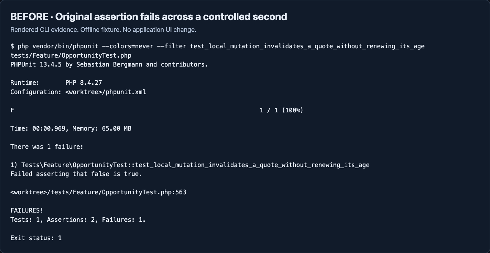
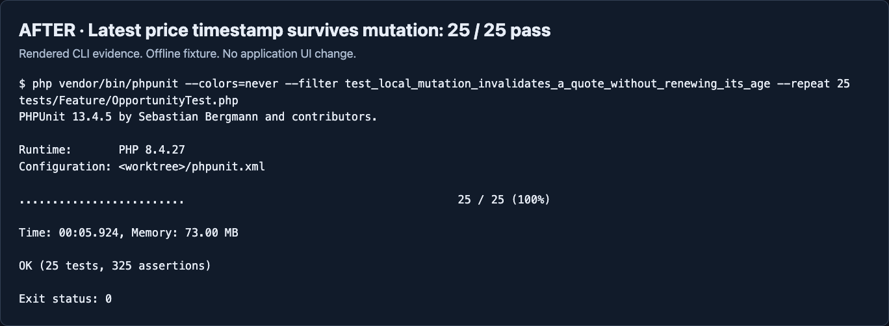

# QA01 verification

Issue [#3](https://github.com/giantsoup/spacetraders/issues/3), designated PR [#4](https://github.com/giantsoup/spacetraders/pull/4). Initial local, remote and PR head: `c178f1b9404c30dafc74382c80d69c5c3c73ac13`. No hard prerequisites were declared. Verification completed on 2026-11-01.

## Before and after

These are screenshots of rendered, captured CLI transcripts, not application UI screenshots. This change affects test acceptance only. Both images use a 1440 x 1000 dark browser viewport and the same synthetic world definition from `FakeSpaceTraders`; each test owns a fresh world file and in-memory SQLite database. Worktree paths are redacted as `<worktree>`. ANSI colors and trailing whitespace are removed from saved transcripts.





The untouched baseline failed on repetition 6 of 10 at the original timestamp assertion. PHPUnit skipped the remaining four repetitions. See [the original baseline output](before-baseline.txt).

Before fixing the assertion, adding only a frozen clock and a one-second advance between initial sync and the command helper reproduced the same failure deterministically. See [the clock-only patch](before-clock-only.patch) and [its failing output](before-controlled-clock.txt).

## What the regression proves

The test freezes time at 12:00:00 UTC. Initial synchronization records a detailed quote. At 12:00:01, the existing command helper performs preview, approval and execution, including legitimate market-price observations. HTTP request middleware captures the most recent quote and price-history count immediately before the fake purchase POST, then advances to 12:00:02. The unchanged production executor confirms the purchase and invalidates the quote.

Assertions require a confirmed purchase, a price observation at 12:00:01 that is newer than the initial quote, a later mutation time, preservation of that latest observation timestamp, no extra price-history entry, the correct invalidating action ID, and `priced_stale` classification. Existing orbit, navigation and travel-history checks remain intact. No sleeps or production rule changes were added.

## Results

- [Isolated regression](after-repeat.txt): 25 of 25 passed, 325 assertions, no skipped repetitions.
- [`scripts/verify.sh`](verify.txt): passed. Production builds were identical across unrelated content fixtures. Frontend state, gameplay, timezone, tutorial and guided-flight checks passed. All 293 backend tests passed with 1,534 assertions. Pint and whitespace checks passed. Tracked build assets remained unchanged.
- [Opportunity browser journey](browser.txt): passed through real handlers and finite database workers against an owned offline provider. Verified coverage and quote presentation, scouting, 4/4/2 trade batches, return/refuel accounting, travel analysis and evidence export. Desktop 1440 px and mobile 390 px checks passed with no page, console or server errors. The script closed its browser and temporary loopback server.
- [Real worker scenarios](worker.txt): all five passed, 116 checks total. Complete contract work and process death at accept, buy, deliver and fulfill boundaries preserved uncertain actions without duplicate writes.
- [Renewed-age negative control](mutation-renewed-age.txt): deliberately setting `observed_at = now()` in `invalidateMarket` made the regression fail at the preserved-timestamp assertion.
- [Missing-observation negative control](mutation-skipped-price-refresh.txt): deliberately removing the trade preflight observation made the regression fail at the fresh-observation assertion.

Both temporary production mutations were restored byte-for-byte. The final regression passed again with 13 assertions, and the final diff contains no production changes. `composer check-platform-reqs` also passed.

## Re-run

Install the locked dependencies into this worktree as documented in the repository README. Use PHP 8.4.27, Node 26.13.0 and pnpm 12.16.1. The commands used for the acceptance checks are:

```bash
php vendor/bin/phpunit --colors=never \
    --filter test_local_mutation_invalidates_a_quote_without_renewing_its_age \
    --repeat 25 tests/Feature/OpportunityTest.php
./scripts/verify.sh
php scripts/verify-automation-worker.php
node scripts/verify-opportunities-browser.mjs
```

Set `PNPM_BIN` when pnpm is outside PATH. The browser run used an owned Playwright 1.65.0-alpha-2026-10-30 installation via `PLAYWRIGHT_MODULE`, installed Chromium 1217 via `PLAYWRIGHT_EXECUTABLE`, and an owned `QA_ARTIFACT_DIR`. The full suite uses disposable SQLite and synthetic HTTP with stray requests blocked. No existing site environment, database, credential or game history was read or copied.

To regenerate the CLI images, set those Playwright variables and run:

```bash
node docs/issue-3/evidence/qa01-20261101-586a896e/render-cli.mjs
```

## Scope and review

Offline acceptance is met. PR #4 stays draft for Taylor's review. Self-review covered the actual final diff, evidence images, test boundaries and restored production files. No independent model review was run; no worker was delegated.

The runtime, dependencies, authentication, spending controls, Stop behavior, reset handling and uncertain-write reconciliation are unchanged. Reverting the implementation commit restores the prior test and documentation; no migration is needed. This evidence makes no claim about live gameplay, deployment, shared-host changes or a primary environment migration.
