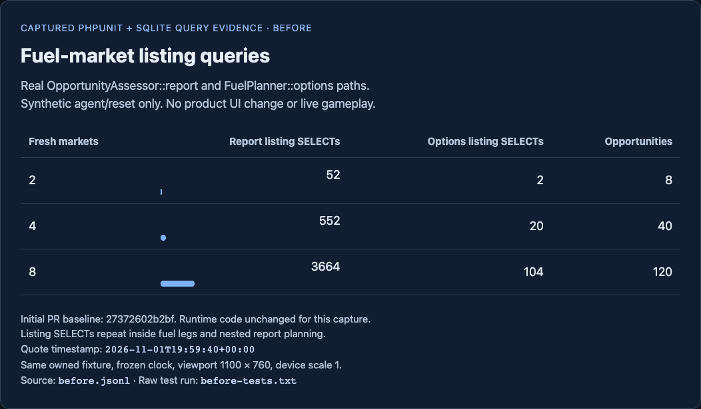
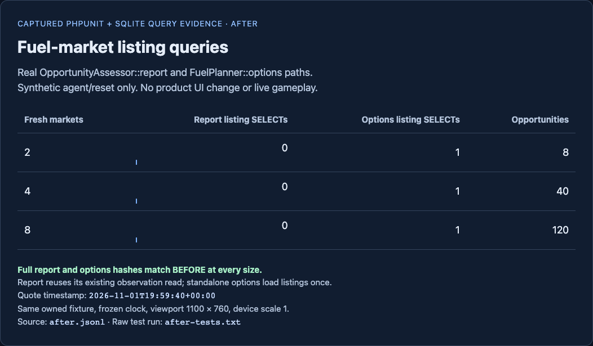

# OPT01 verification

Refs #79 and existing PR https://github.com/giantsoup/spacetraders/pull/80. Milestone M10 is unchanged. No hard prerequisites are declared.

## Result

FuelPlanner reads all market listings for the current agent and reset once per standalone planning scope. OpportunityAssessor passes the listings from its existing scoped observation read through cargo, mining, trade and observation-route planning. OperationPlanner and SurveyPool also reuse one batch within each preview or assessment. No singleton state, generic repository, persistent cache, schema change or dependency change was added.

Only directory observations are reused. Each fuel leg still reads detailed market quotes and checks their original observation time, invalidation, positive fuel price, trade volume, system, remaining fuel, tank capacity and protected credits. Imports-only markets remain ineligible fuel sellers; exports, exchange and the existing missing-directory fallback retain their behavior. Sorting and returned route data are unchanged in the captured fixture.

## Captured performance evidence





These images are browser-rendered performance reports of actual PHPUnit and SQLite query captures. They do not depict a product UI change. Both use a 1100 by 760 viewport, device scale 1, the same synthetic fixture and a frozen UTC clock. The renderer captures the report region and blocks external browser requests. Both delivered images were inspected for legibility and truthful state.

| Markets | Report listing SELECTs before | After | Options listing SELECTs before | After | Opportunities |
| --- | --- | --- | --- | --- | --- |
| 2 | 52 | 0 | 2 | 1 | 8 |
| 4 | 552 | 0 | 20 | 1 | 40 |
| 8 | 3664 | 0 | 104 | 1 | 120 |

Zero means no additional listing query beyond the report's existing observation read. Other queries remain outside this optimization. Total report queries are 119/851/4619 before and 67/299/955 after. The 8-market fixture reaches the existing 120-opportunity cap. The fixture includes one ship with retained cargo, three shared goods, a mining site and observation questions that exercise nested route options.

The BEFORE capture ran against unmodified application code at initial head `27372602b2bffea48c0841955b7ca4aa20d6c320`, before editing application files. Only the new probe and evidence renderer existed at that point. The final regression file adds query-bound and safety assertions after that capture. [before.jsonl](evidence/20261101-opt01/before.jsonl) and [after.jsonl](evidence/20261101-opt01/after.jsonl) contain actual query counts and SHA-256 hashes of the complete serialized reports and route options. All six result hashes match. Quote timestamps remain `2026-11-01T19:59:40+00:00`.

## Verification

- Initial full backend suite: 293 tests, 1528 assertions, all pass. The older PR brief's QA01 failure did not reproduce on this baseline.
- Final focused suite: 24 tests, 123 assertions, all pass. Covers real multi-market report/options paths, sellers, freshness boundary, stale and invalidated quotes, price and volume, fuel/capacity/credit bounds, no observation writes, current affordability with reused batches, agent/reset isolation, same-instance calls, empty directories, operation previews and survey assessments. `tests/Feature/OpportunityTest.php` was not edited.
- Final full backend suite: 317 tests, 1651 assertions, all pass. See [final-suite.txt](evidence/20261101-opt01/final-suite.txt).
- Deterministic production build passed twice; tracked `public/build` remains byte-for-byte unchanged. Pinia, gameplay, timezone, tutorial and guided-flight checks pass. See [build.txt](evidence/20261101-opt01/build.txt) and [frontend.txt](evidence/20261101-opt01/frontend.txt).
- `php scripts/verify-mvp-worker.php` passed actual disposable database workers, duplicate delivery, confirmed mining completion, SIGKILL/lost-response recovery, uncertain-write non-replay and offline Stop. See [worker.txt](evidence/20261101-opt01/worker.txt). These are synthetic outcomes.
- Shared preview browser smoke check used an incognito profile and a separate owned offline SQLite/world/key/session/lock fixture on a finite loopback server. Logged in through the normal form, opened the agent flight deck and synchronized. Verified the dark opportunities panel, independent quote/directory ages, fresh local prices, unknown remote prices and an observation-route candidate. No console errors were observed. The fake world's write list stayed empty. The tab and server were closed. See [browser.json](evidence/20261101-opt01/browser.json).
- Composer validation/platform checks, affected-file Pint and `git diff --check` pass. PHP 8.4.27, Node 26.13.0 and pnpm 12.16.1 were used. Locked dependencies were installed within this worktree; no primary environment, database or game credentials were read or copied.

Captured test logs replace only the absolute configuration path with `phpunit.xml [owned worktree]`; worker logs omit the private temporary-directory path. No keys, credentials or environment files are published.

## Rerun

With the locked dependencies installed in an isolated checkout:

```sh
php vendor/bin/phpunit tests/Feature/Opt01FuelListingBatchTest.php --colors=never
php vendor/bin/phpunit --colors=never
php scripts/verify-mvp-worker.php
```

To regenerate the final query report, choose a new evidence directory, copy the captured `before.jsonl` into it and set `OPT01_EVIDENCE_PATH` to a new `after.jsonl` file. The probe appends one record for each fixture size, so start with an absent output file.

```sh
OPT01_EVIDENCE_PATH=YOUR_EVIDENCE_DIR/after.jsonl php vendor/bin/phpunit tests/Feature/Opt01FuelListingBatchTest.php --colors=never
PLAYWRIGHT_MODULE=YOUR_PLAYWRIGHT_MODULE PLAYWRIGHT_EXECUTABLE=YOUR_CHROMIUM_BINARY node scripts/render-opt01-evidence.mjs after YOUR_EVIDENCE_DIR
```

The renderer verifies result hashes against BEFORE and asserts zero extra report listing queries and one options listing query. It fails if any result differs. To recapture BEFORE independently, run the final probe in a separate owned checkout at the initial baseline with `--filter=test_multi_market_report_and_route_options_query_scaling`. Those tests intentionally fail their new query bounds there after recording each baseline JSON row. No baseline failure should be presented as a passing optimization test.

## Review and rollback

All offline issue acceptance checks pass. The PR stays draft for Taylor's review. No independent model review was run; no workers were delegated. Live gameplay and deployment are outside this task and require separate authorization. No such action is needed to accept this query optimization.

The change affects fuel planning in reports, standalone options, operation previews and survey assessments. A listing snapshot stays fixed within one synchronous planning scope; quotes and affordability are rechecked for each leg. Callers must pass only the current agent/reset's keyed listing collection. No collection is stored on the planner or carried into a worker execution. Reverting the implementation commit restores per-market queries without a database migration or data rollback.
