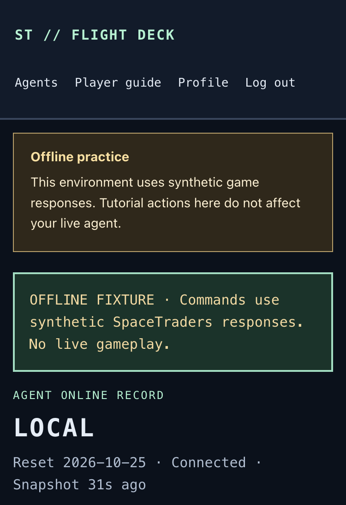
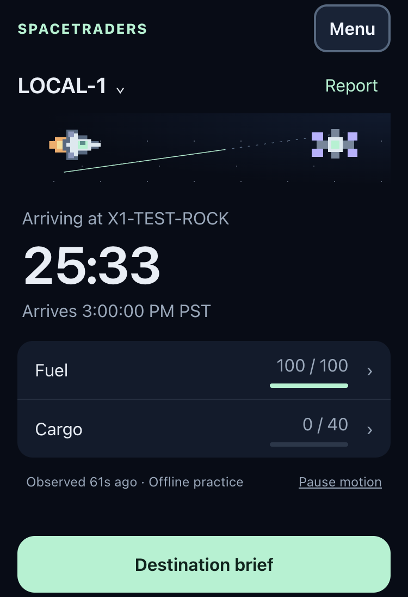

# Native ship UI implementation

UI01, issue #5, designated draft [PR #6](https://github.com/giantsoup/spacetraders/pull/6). Reverified on November 1, 2026 in the dedicated PR worktree. Starting head `4bf70d7ce98c340f3ded63666876d265bbb9b1a0` matched the remote. No hard prerequisites are declared.

The implementation reuses commit `da1da847e6c2234331317b98ced76afe0bc2b745` through cherry-pick `8dbf3a8`. The original worktree was not modified. This report replaces that commit's historical acceptance claims with current evidence.

The connected UI and offline browser journeys pass. The complete backend run has one intermittent, pre-existing QA01 failure at `OpportunityTest.php:561`. PR #6 remains draft pending that gate and Taylor's acceptance. No independent model review was run in this execution.

## Capability destinations

The destination map was recorded before integration and retained:

| Capability | Destination |
| --- | --- |
| Selected ship, navigation, absolute ETA, fuel and cargo | Horizon home |
| Crew, readiness, components, equipment and observation time | Report; ship and Report open the same sheet |
| Tank units and observed inventory | Fuel and Cargo open their Report section |
| Manual commands, surveys, transfers and one-time miner setup | Commands |
| Expiring manual and bounded-run previews | Review approval |
| Complete command history, unresolved outcomes and reconciliation | Activity history, including older-command pagination |
| Current run step, approved limits, blocker and Stop | Active run; Stop is also on home |
| Bounded mining, scouting and trading | Automation |
| Mining and Contracts investigation, drafts, preview and approval | Existing local automation console inside Automation |
| Engine health, Start and End session | Separate controls inside Automation |
| Waypoints, market evidence, opportunities and calibration | Intelligence |
| Guided flight and lessons | Guide; active steps reveal their real destination |
| Owned-ship selection | Fleet; existing user/agent/reset browser key |
| Agents, player guide, profile and sign-out | Menu |

## Implementation choices and boundaries

`Dashboard.vue` retains existing form state and handlers while opening one focused destination. `FocusSheet.vue` provides dismissal, Escape, keyboard containment and focus return. `ShipScene.vue`, `ShipReport.vue` and `shipPresentation.js` separate decoration, observed details and absolute timing. Shared `command.css` tokens and `AppShell.vue` keep the application dark under either OS preference.

Intentional departures from the reference are the actual observed ship symbol, a compact Menu header and full existing forms in scrolling sheets. Art shrinks before essential content. Systems moves into Report on short screens. Long names, landscape and enlarged text scroll. No nickname, selectable application theme or new gameplay capability was added.

The owner-scoped history GET returns at most 40 older actions plus a continuation flag, with no upstream request. Tests cover ownership, invalid cursors, pagination and absence of credentials. The client retains older history across polling and can reopen older previews. The read-only OpportunityAssessor change lists incomplete ship observations instead of inventing planning values or crashing.

Execution remains in the existing server services. Preview/approval, CSRF, ownership, integer bounds, protected reserves, reset invalidation, duplicate prevention and uncertain-write reconciliation retain their authority. Confirmed transactions with review flags stay confirmed. Stop remains requested while reserved work settles. Starting the engine alone authorizes no gameplay; End session and run Stop remain distinct. Neither FuelPlanner nor QA01's OpportunityTest assertion was changed. The extra UI checks in `scripts/verify.sh` remain present for later OPS01 integration.

Material paths are `resources/js/Pages/Agent/Dashboard.vue`, `Layouts/AppShell.vue`, `Components/{FocusSheet,ShipScene,ShipReport,GuidedFlight,AutomationConsole,OperationControls,OpportunityPanel}.vue`, `shipPresentation.js`, `dateTime.js`, shared CSS and viewport metadata; the dashboard controller/history route and observation assessor; targeted GameplayTest coverage; browser scripts; and matching tracked `public/build`. Dependency manifests, lockfiles and migrations are unchanged.

## Fresh application evidence

All delivered evidence is under [issue-5/evidence/2026-11-01-ui01](issue-5/evidence/2026-11-01-ui01). Screenshots are actual Vue application renders with synthetic observations. They are not prototype images.

Before and after used the same disposable SQLite database, fake world, selected LOCAL-1 ship, transit route, 100/100 tank and empty 0/40 hold at `http://127.0.0.1:49766/agents/1`. The arrival source stayed `2026-11-01T23:00:00Z`. Capture time and observation age advanced naturally. T3 preview used an isolated incognito profile and the same viewport for each pair. Its finite fixture server and tab are closed after capture.

| Before | After |
| --- | --- |
|  |  |
| [390 × 844 baseline](issue-5/evidence/2026-11-01-ui01/before-transit-390x844.png) | [390 × 844 Horizon](issue-5/evidence/2026-11-01-ui01/after-transit-390x844.png) |

Additional current screenshots:

| Image | Actual state |
| --- | --- |
| [320 × 667 transit](issue-5/evidence/2026-11-01-ui01/transit-320x667.png) | All essential rows and primary action inside the viewport |
| [Systems report](issue-5/evidence/2026-11-01-ui01/after-report-systems-390x844.png), [Cargo](issue-5/evidence/2026-11-01-ui01/report-cargo.png) | Separate crew, component condition/integrity, empty inventory |
| [Manual approval](issue-5/evidence/2026-11-01-ui01/command-approval.png) | Persisted orbit preview before separate approval |
| [Stop requested](issue-5/evidence/2026-11-01-ui01/run-stop-requested.png) | Real Stop handler; reserved ownership still settling |
| [Arrival due](issue-5/evidence/2026-11-01-ui01/arrival-due.png), [uncertain action](issue-5/evidence/2026-11-01-ui01/action-uncertain.png) | Checking at zero; unresolved action takes priority |
| [Missing fields](issue-5/evidence/2026-11-01-ui01/missing-fields.png) | Unknown observations remain explicit |
| [Landscape](issue-5/evidence/2026-11-01-ui01/long-844.png), [enlarged text](issue-5/evidence/2026-11-01-ui01/enlarged-text.png) | Full scrollable documents captured from 844 × 390 and 320 × 667 viewports; long symbols and 24px text |
| [Guided mobile](issue-5/evidence/2026-11-01-ui01/guided-mobile.png) | Actual instructions and highlighted protected-credit field remain visible |

Every delivered image was inspected for legibility, cropping and truthful state. The manifest records their SHA-256 hashes. Additional state screenshots stay in ignored local test output.

## Current verification

Runtime: PHP 8.4.27, Node 26.13.0, pnpm 12.16.1 and installed Chrome 156.0.8078.76. Dependencies are this worktree's own installations. No primary environment, credential, database or gameplay history was copied. Browser runners use private fixtures and block external browser traffic; fake upstream transport prevents stray API requests. Workers and engine service identities belong to disposable fixtures.

Commands used the installed Playwright module through `PLAYWRIGHT_MODULE` and Chrome through `PLAYWRIGHT_EXECUTABLE`, as documented in README. `PNPM_BIN=/tmp/ui01-pnpm` invoked `npm exec --yes --package=pnpm@12.16.1 -- pnpm` without a global runtime change.

| Command | Actual result and retained evidence |
| --- | --- |
| `php vendor/bin/phpunit --display-all-issues`, invoked on the baseline | 293 tests / 1,528 assertions passed; [baseline-tests.log](issue-5/evidence/2026-11-01-ui01/baseline-tests.log) |
| `PNPM_BIN=/tmp/ui01-pnpm bash scripts/verify.sh` | Both production builds and source-scan determinism, Pinia, gameplay, local-time, ship-presentation, tutorial, guided-flight and isolated environment checks passed. Backend: 296 tests / 1,557 assertions, one QA01 failure. Script exited 1 before Pint. [verify.log](issue-5/evidence/2026-11-01-ui01/verify.log) |
| `php vendor/bin/pint --test app/Gameplay/OpportunityAssessor.php app/Http/Controllers/AgentDashboardController.php routes/web.php tests/Feature/GameplayTest.php` | Passed separately after the suite stopped; [pint.log](issue-5/evidence/2026-11-01-ui01/pint.log) |
| `composer validate --strict`; `composer check-platform-reqs` | Passed; [manifest](issue-5/evidence/2026-11-01-ui01/composer-validate.log), [platform](issue-5/evidence/2026-11-01-ui01/platform.log) |
| `node scripts/verify-native-ship-browser.mjs` | Passed 12 measured docked/orbit/transit/cooldown portrait layouts at 320 × 667, 375 × 548 and 390 × 844. Report/deep links, Back/Forward, focus containment/return, manual approval and actual worker confirmation, 95-command history, reconciliation, Stop, arrival due, pause/resume, reduced motion, stale/disconnected, unknown/zero-capacity, empty/no-ship/archive, 844 × 390 landscape, 1440 × 1000 and enlarged text passed. [Structured results](issue-5/evidence/2026-11-01-ui01/native-browser-results.json) |
| `node scripts/verify-ship-https-browser.mjs` | Owned loopback TLS proxy: authentication, trusted forwarded HTTPS, assets, Report, CSRF-protected preview and Menu-to-guide passed; [results](issue-5/evidence/2026-11-01-ui01/https-results.json) |
| `node scripts/verify-guided-browser.mjs` and `QA_GUIDED_SCENARIO=setup\|uncertain\|rejected\|recovery\|preparation\|scroll` | All seven passed: normal 44 steps, setup 43, uncertain 17, rejected 17, recovery 44, preparation 46, scroll 5. Each scenario has a committed log and structured result in the evidence directory. No uncertain mutation was replayed. |
| `node scripts/verify-automation-browser.mjs` | Mining and offered Contracts investigation, staging/reload, exact approval, changed-price rejection, real outcomes, accounting, validation/focus, End/restart and Stop passed. Service removal verified; [results](issue-5/evidence/2026-11-01-ui01/automation-results.json) |
| `node scripts/verify-opportunities-browser.mjs` | Purposeful scout and trade 4/4/2 batches, real worker completion, return/refuel and evidence views passed; [results](issue-5/evidence/2026-11-01-ui01/opportunities-results.json) |
| `node scripts/verify-tutorial-browser.mjs` | Corrected runner passed all five journey groups, including selected-ship persistence, manual mining/sales, storage boundaries, mobile and keyboard behavior; [results](issue-5/evidence/2026-11-01-ui01/tutorial-results.json) |
| `node scripts/verify-agents-browser.mjs`; `node scripts/verify-pages-browser.mjs`; `node scripts/verify-presentation-browser.mjs` | Passed archive/reset recovery, account/shared-shell flows, both OS themes, narrow layouts, local time/raw UTC values and escaped evidence. Individual logs and JSON results are committed. |
| `php scripts/verify-mvp-worker.php`; `php scripts/verify-automation-worker.php` | Passed real file-backed worker restart/duplicate delivery, SIGKILL after upstream commit, no replay, offline Stop, and all five automation crash/settlement cases. [MVP log](issue-5/evidence/2026-11-01-ui01/mvp-worker.log), [automation log](issue-5/evidence/2026-11-01-ui01/workers.log) |
| `node --check` for changed browser runners; `git diff --check`; build comparison against integrated assets | Passed. Current production output matches the integrated tracked build. |

## Failures and unresolved gate

The first native browser run overlapped the deterministic build check and encountered a temporarily missing Vite manifest, producing HTTP 500. It is retained in [native-browser-initial-failure.log](issue-5/evidence/2026-11-01-ui01/native-browser-initial-failure.log). Running after the builds completed passed. This was verification sequencing, not an application-state pass.

The tutorial runner initially read a detached guide element during Inertia navigation and received an empty computed background. The failure is retained in [tutorial-initial-failure.log](issue-5/evidence/2026-11-01-ui01/tutorial-initial-failure.log). Waiting for the selected agent-guide URL before checking the next lesson fixed the runner; the full journey passed afterward. The native runner now captures landscape and enlarged-text evidence as full scrollable documents so the images do not imply viewport fit.

The complete backend suite failed `test_local_mutation_invalidates_a_quote_without_renewing_its_age` at line 561. A focused current run passed. Repeating that exact test with the original `4bf70d7` OpportunityAssessor preloaded produced three passes then the same failure. The assertion fails before the report call; its executor, synchronizer and test source are unchanged. [Baseline reproduction log](issue-5/evidence/2026-11-01-ui01/qa01-baseline-repeated.log) preserves every attempt. This confirms the known QA01 timing-dependent gate, not a clean full-suite result. No assertion was weakened or skipped. QA01 must resolve it before final acceptance.

## Limits and rollback

Local Chrome and synthetic gameplay are verified. Physical phones, Safari, VoiceOver, actual OS sleep/wake, live SpaceTraders acceptance, profitability and deployment remain unverified. Lifecycle checks use controlled visibility/resume events and absolute clock advancement. No live read, game write, purchase, paid call, Discord/email message, credential change, shared-host operation or deployment occurred.

The finite screenshot server and browser tab are closed; fixture services are removed. Re-run the committed browser scripts to create a new private local preview. Existing Herd sites were unchanged.

Rollback is a normal revert of this PR's code and matching production assets. There are no new migrations or dependency changes. Stop and settle any approved work before replacing a running application; reverting UI code does not undo upstream game actions. This execution did not activate live work.
